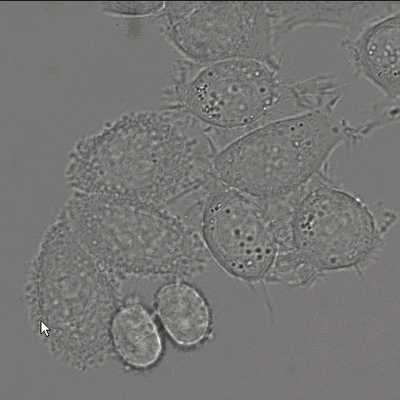
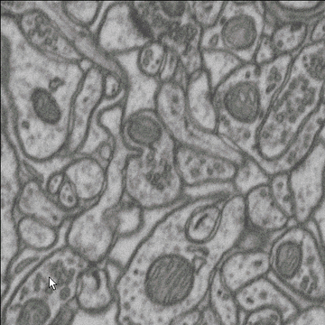
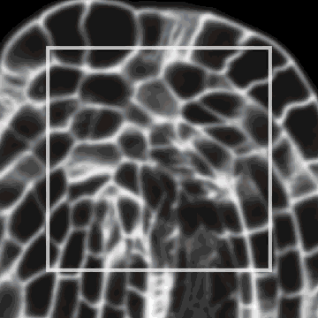
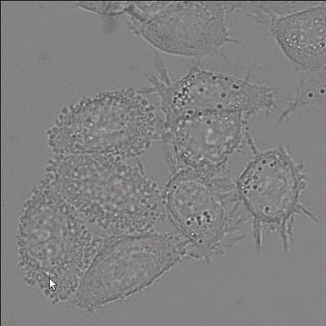
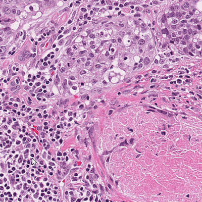
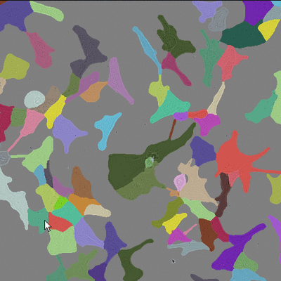
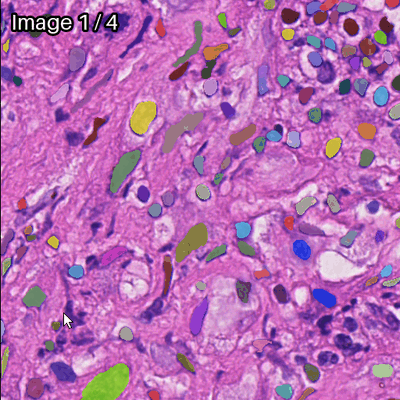

[![Image.sc forum][imagesc-img]][imagesc-url]

# Segment Anything for Microscopy 2

<a href="https://github.com/computational-cell-analytics/micro-sam">

Tools for segmentation, tracking and classification in microscopy built on [Segment Anything 2 (SAM2)](https://ai.meta.com/sam2/).
Segment, track and classify objects in microscopy images interactively with a few clicks, or automatically.

We implement napari applications for:
- interactive and automatic segmentation of 2d images and 3d volumes
- interactive and automatic tracking of cells in 2d timeseries
- classification of segmented objects, for example into cell types
- pixel classification, for example for tissue or region segmentation
- batch annotation of all images in a folder with any of these tools

We also provide the `micro-sam2` models, which are finetuned on microscopy data, and the `micro_sam` python library to apply them to your data and to finetune them.
The functionality of the previous version, based on the original [Segment Anything](https://segment-anything.com/) (SAM1), is still available in the `micro_sam.v1` subpackage and in the `micro_sam v1` command line tools.

<table>
<tr>
<td align="center"> Interactive Cell Segmentation in 2D</td>
<td align="center"> Interactive Mitochondria Segmentation in volumeEM</td>
<td align="center"> Automatic Cell Segmentation in 3D</td>
<td align="center"> Interactive Cell Tracking in 2D+T</td>
</tr>
</table>
<table align="center">
<tr>
<td align="center"> Pixel Classification in Histopathology</td>
<td align="center"> Object Classification with Corrections</td>
<td align="center"> Batch Nucleus Classification in Histopathology</td>
</tr>
</table>

If you run into any problems or have questions about our tool, please open an [issue](https://github.com/computational-cell-analytics/micro-sam/issues/new/choose) on GitHub or contact us via [image.sc](https://forum.image.sc/) using the tag `micro-sam`, and tagging [@anwai98](https://forum.image.sc/u/anwai98/summary) and [@constantinpape](https://forum.image.sc/u/constantinpape/summary).
You can follow recent updates on `micro_sam` in our [news feed](https://forum.image.sc/t/microsam-news-feed).

## Installation and Usage

Please check [the documentation](https://computational-cell-analytics.github.io/micro-sam/) for details on how to install and use `micro_sam`. You can also watch [the quickstart video](https://youtu.be/gcv0fa84mCc), [our virtual I2K workshop video](https://www.youtube.com/watch?v=dxjU4W7bCis&list=PLdA9Vgd1gxTbvxmtk9CASftUOl_XItjDN&index=33) or [all video tutorials](https://youtube.com/playlist?list=PLwYZXQJ3f36GQPpKCrSbHjGiH39X4XjSO&si=qNbB8IFXqAX33r_Z). The videos show the previous version, so the user interface differs from the current one.

`micro_sam` works best with a GPU or on a Mac with an M-series chip. On a CPU it is slow, in particular for 3d segmentation.

## Contributing

We always welcome new contributions!

If you just want to suggest a documentation edit, [you can do this directly here, on GitHub][edit-files-on-github].
For more complex changes, see [CONTRIBUTING.md][contributing] or the [contributing guide](https://computational-cell-analytics.github.io/micro-sam/micro_sam.html#contribution-guide) in our documentation for details. The first step is to [discuss your idea in a new issue](https://github.com/computational-cell-analytics/micro-sam/issues/new) with the current developers.

Everyone participating in this project is expected to follow our [Code of Conduct][code-of-conduct].

## Citation

If you use this repository in your research, please cite
- our [μSAM2 preprint](https://doi.org/10.64898/2026.11.12.766082)
- our [μSAM publication](https://www.nature.com/articles/s41592-024-02580-4) (published in Nature Methods)
- and the [Segment Anything 2 publication](https://arxiv.org/abs/2408.00714).
- If you use automatic tracking, please also cite [Trackastra](https://arxiv.org/abs/2405.15700).
- If you use automatic prompt generation (APG), please also cite [our μSAM++ paper](https://openreview.net/forum?id=xFO3DFZN45).
- If you use the SAM1 functionality in `micro_sam.v1`, please also cite the [Segment Anything publication](https://arxiv.org/abs/2304.02643), and [MobileSAM](https://arxiv.org/abs/2306.14289) if you use a `vit_t` model.

## Related Projects

There is one other napari plugin built around Segment Anything 2:
- https://github.com/royerlab/napari-segment-anything-2 (2d and video support)

Compared to this plugin we support more applications (2d, 3d, tracking and classification), and provide finetuning methods and finetuned models for microscopy data.
[WebKnossos](https://webknossos.org/), [QuPath](https://github.com/ksugar/qupath-extension-sam) and [Fiji](https://github.com/segment-anything-models-java/SAMJ-IJ) also integrate Segment Anything 2 for interactive segmentation, mainly in 2d.

## Release Overview

You can find an overview of changes introduced in previous releases [here](https://github.com/computational-cell-analytics/micro-sam/blob/main/RELEASE_OVERVIEW.md).

[imagesc-img]: https://img.shields.io/badge/dynamic/json.svg?label=forum&url=https%3A%2F%2Fforum.image.sc%2Ftags%2Fmicro-sam.json&query=%24.topic_list.tags.0.topic_count&colorB=brightgreen&suffix=%20topics&logo=
[imagesc-url]: https://forum.image.sc/tag/micro-sam
[contributing]: https://github.com/computational-cell-analytics/micro-sam/blob/main/CONTRIBUTING.md
[code-of-conduct]: https://github.com/computational-cell-analytics/micro-sam/blob/main/CODE_OF_CONDUCT.md
[edit-files-on-github]: https://docs.github.com/en/repositories/working-with-files/managing-files/editing-files
